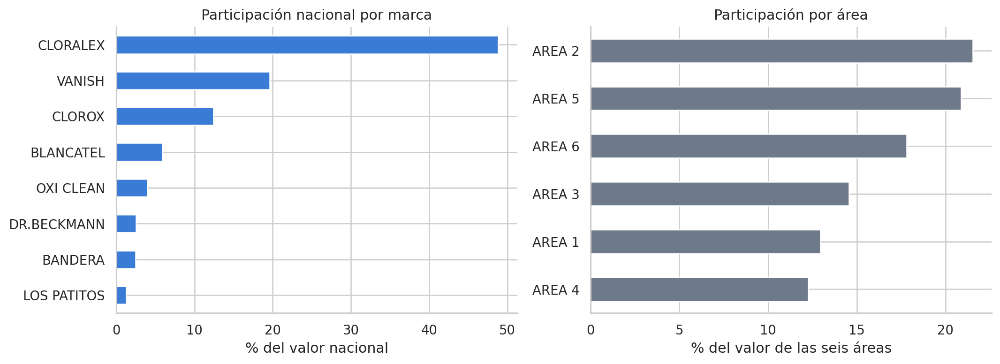
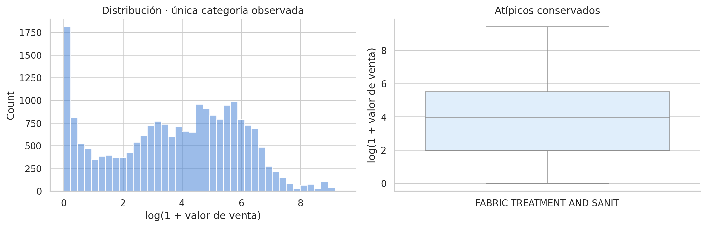
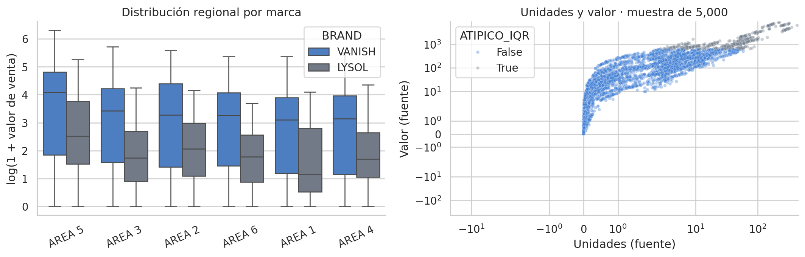

# Ventas de productos de consumo · Vanish y Lysol

**Autor:** Javier Bueno Sánchez · EBAC, Profesión Científico de Datos

## Propósito

Integrar análisis comercial, segmentación de productos, SQL, Power BI y pronósticos.

## Técnicas

Python, pandas, K-Means, SQL, Power BI, regresión y series temporales.

## Archivos

- [Avance de Proyecto parte 4.pdf](Avance%20de%20Proyecto%20parte%204.pdf)
- [Captura_Escenarios_Entregable_5_Empresa_Aliada_Javier_Bueno_Sanchez.png](Captura_Escenarios_Entregable_5_Empresa_Aliada_Javier_Bueno_Sanchez.png)
- [Captura_Mapa_ilustrativo_Entregable_5_Empresa_Aliada_Javier_Bueno_Sanchez.png](Captura_Mapa_ilustrativo_Entregable_5_Empresa_Aliada_Javier_Bueno_Sanchez.png)
- [Captura_Productos_y_areas_Entregable_5_Empresa_Aliada_Javier_Bueno_Sanchez.png](Captura_Productos_y_areas_Entregable_5_Empresa_Aliada_Javier_Bueno_Sanchez.png)
- [Captura_Resumen_nacional_Entregable_5_Empresa_Aliada_Javier_Bueno_Sanchez.png](Captura_Resumen_nacional_Entregable_5_Empresa_Aliada_Javier_Bueno_Sanchez.png)
- [Dashboard Entregable 5 Empresa Aliada Javier Bueno Sanchez.pbix](Dashboard%20Entregable%205%20Empresa%20Aliada%20Javier%20Bueno%20Sanchez.pbix)
- [Enlace informe Entregable 5 Empresa Aliada Javier Bueno Sanchez.txt](Enlace%20informe%20Entregable%205%20Empresa%20Aliada%20Javier%20Bueno%20Sanchez.txt)
- [Entrega_Final_Javier_Bueno_Sanchez.ipynb](Entrega_Final_Javier_Bueno_Sanchez.ipynb)
- [Entrega_Final_Javier_Bueno_Sanchez.pdf](Entrega_Final_Javier_Bueno_Sanchez.pdf)
- [Entregable_6_Javier_Bueno_Sanchez.ipynb](Entregable_6_Javier_Bueno_Sanchez.ipynb)
- [Guia y evidencias Entregable 5 Empresa Aliada Javier Bueno Sanchez.pdf](Guia%20y%20evidencias%20Entregable%205%20Empresa%20Aliada%20Javier%20Bueno%20Sanchez.pdf)
- [Informe_Entregable_6_Javier_Bueno_Sanchez.pdf](Informe_Entregable_6_Javier_Bueno_Sanchez.pdf)
- [Instrucciones de Entregable 5 Empresa Aliada Javier Bueno Sanchez.txt](Instrucciones%20de%20Entregable%205%20Empresa%20Aliada%20Javier%20Bueno%20Sanchez.txt)
- [Presentacion_Final_Javier_Bueno_Sanchez.pptx](Presentacion_Final_Javier_Bueno_Sanchez.pptx)
- [Tarea M-27-CD Entregable 3 Javier Bueno Sanchez.ipynb](Tarea%20M-27-CD%20Entregable%203%20Javier%20Bueno%20Sanchez.ipynb)
- [Tarea M-27-CD Entregable 3 Javier Bueno Sanchez.pdf](Tarea%20M-27-CD%20Entregable%203%20Javier%20Bueno%20Sanchez.pdf)
- [Tarea M42 CD Proyecto empresa aliada entregable 4 Javier Bueno Sánchez..pdf](Tarea%20M42%20CD%20Proyecto%20empresa%20aliada%20entregable%204%20Javier%20Bueno%20S%C3%A1nchez..pdf)

## Datos y reproducción

Consulte [DATOS.md](DATOS.md). Abra Jupyter desde esta carpeta y ejecute las celdas en orden después de aportar los datos. El entorno sugerido está en [requirements.txt](../../requirements.txt); no se ha validado un entorno único para todas las actividades. Las salidas incluidas son históricas, no una ejecución nueva. Los archivos `.pbix` requieren Power BI Desktop y pueden necesitar restablecer las rutas de origen.

La entrega final carga los datos desde `data/`; el entregable 6 los carga desde su carpeta o `upload/`. Son ejercicios distintos: no deben combinarse sus métricas ni confundirse ventas en valor con ventas en volumen. Los pronósticos parten del histórico de 2023.

## Conclusiones documentadas en el trabajo

Los siguientes extractos proceden de los notebooks originales; no son resultados recalculados.

### Entrega_Final_Javier_Bueno_Sanchez.ipynb

### Resultados concretos y decisión de uso
- Valor nacional acumulado: **5,521,429.320** unidades originales de valor. Cloralex concentra 48.84%, Vanish 19.64% y Lysol 0.64% del universo observado.
- Las áreas 2, 5 y 6 aportan conjuntamente **60.24%** del valor de las áreas. Bleach concentra **68.65%** del nacional.
- K-Means reproduce **k=4**, silueta **0.4934** y perfiles de 16, 24, 17 y 19 productos. Alta rotación y alto valor aportan 98.98% del valor segmentado. Dos casos son fronterizos y un SKU quedó excluido solo del clustering.
- **Vanish:** ARIMA(1,0,2) gana en validación (MAE 585.08). En prueba, su MAE sube a 2,130.90 y la regresión obtiene 1,166.72. El ranking no es estable entre periodos.
- **Lysol:** ARIMA(0,1,1) gana en validación (MAE 18.90). En prueba, obtiene MAE 22.31 frente a 22.13 de la última semana. La mejora de complejidad no se confirma.
- Se conservan los métodos elegidos antes de prueba para generar la proyección académica. **No hay evidencia suficiente para automatizar pedidos.** Antes de cambiar la selección se requiere nueva validación de origen móvil, sin reutilizar este bloque de prueba como selección.
- La evaluación cubre 12 semanas, mientras que el pronóstico alcanza 15. Las últimas tres semanas requieren cautela adicional. Evaluar 16 configuraciones ARIMA sobre una validación corta también puede sobreajustar la selección.

Los escenarios anteriores del PBIX y los resultados del entregable 6 previo usan otro protocolo. Esta entrega final incorpora regresión y un bloque independiente de selección. Los CSV de este paquete son la referencia numérica para estas diapositivas.

### Entregable_6_Javier_Bueno_Sanchez.ipynb

**Qué demuestran los datos.** Las métricas anteriores cuantifican errores sobre 12 semanas no utilizadas para seleccionar ni entrenar el modelo. No garantizan desempeño en otro periodo ni permiten atribuir causas a los cambios de ventas.

**Qué sostiene el modelo.** El pronóstico depende de la continuidad del patrón reciente y de la cobertura del canal nacional observado. Los modelos recursivos pueden suavizar picos y acumular error. Las ventas registradas no equivalen a demanda no restringida cuando existen faltantes de inventario.

**Qué investigar.** Confirmar la escala de ventas y el calendario, incorporar promociones, precio, disponibilidad y cambios de surtido; reunir más ciclos antes de estimar estacionalidad anual. La base no permite interpretar estas cifras como ventas de todo el mercado mexicano.

**Cómo validar y actuar.** Actualizar semanalmente, comparar cada cierre con la referencia y revisar MAE, WAPE y sesgo. Evaluar de nuevo con orígenes móviles sin reutilizar este test para ajustar parámetros. Usar los volúmenes como insumo de compras y capacidad, condicionados a inventario y plazos; no convertirlos directamente en stock de seguridad sin estudiar el nivel de servicio y los errores por horizonte.

**Cumplimiento de la actividad:** carga y preparación, elección justificada, separación temporal, entrenamiento, ajuste documentado, métricas y gráficos de prueba, pronóstico de tres meses y recomendaciones incluidos.

### Tarea M-27-CD Entregable 3 Javier Bueno Sanchez.ipynb

Conclusiones

El análisis permitió segmentar 76 productos Vanish en cuatro grupos con comportamientos comerciales diferenciados. La elección de cuatro clústeres se sustentó en el coeficiente de silueta, la inercia, la distribución de productos y la utilidad comercial de la segmentación.

El modelo final obtuvo un coeficiente de silueta de 0.4934. Aunque la separación no es absoluta, los perfiles resultaron consistentes y comercialmente interpretables:

- **Alta rotación:** concentra el 84.4 % de las unidades y el 50.8 % del valor vendido.
- **Alto valor:** aporta el 48.2 % del valor con solo el 14.4 % de las unidades.
- **Baja rotación estable:** mantiene continuidad durante el periodo, pero presenta una demanda reducida.
- **Presencia marginal:** registra ventas mínimas y una menor permanencia comercial.

Los segmentos de alta rotación y alto valor reúnen 40 de los 76 productos y generan aproximadamente el 99 % del valor vendido. Esta concentración permite identificar los productos que sostienen el desempeño del portafolio, pero no implica que los demás deban eliminarse.

La revisión de las siluetas individuales mostró 74 asignaciones consistentes y únicamente 2 productos fronterizos. Ambos permanecieron correctamente vinculados al centroide más cercano, aunque su clasificación debe interpretarse con cautela.

La proyección mediante PCA conservó el 87.04 % de la variabilidad. La primera componente representó principalmente la fortaleza comercial, mientras que la segunda diferenció el posicionamiento económico. La visualización confirmó la coherencia general de los cuatro segmentos.

Las variables categóricas disponibles no explicaron la segmentación. CATEGORY y ATTR2 fueron constantes; ATTR1 presentó solo dos casos excepcionales; y la prueba chi-cuadrado no encontró asociación entre ATTR3 y los segmentos (p = 0.8626; V de Cramér = 0.0990). Por tanto, los grupos están definidos principalmente por la rotación, la continuidad y el precio implícito.

Alcance de las recomendaciones

El modelo identifica patrones de comportamiento, pero no determina por sí solo la continuidad, rentabilidad o relevancia estratégica de cada producto. Antes de tomar decisiones sobre el portafolio se requiere incorporar información de margen, costos logísticos, inventario, disponibilidad, promociones, canales, clientes y fechas de incorporación o retiro.

En consecuencia, la segmentación debe utilizarse como una herramienta de priorización para investigar y decidir, no como un mecanismo automático de eliminación de productos.
## Vista rápida

## Limitaciones

Trabajo formativo. Las asociaciones no establecen causalidad. El resultado depende de la fuente, la partición y los supuestos descritos en cada archivo. Revisar la disponibilidad y los derechos de los datos antes de publicarlos.
