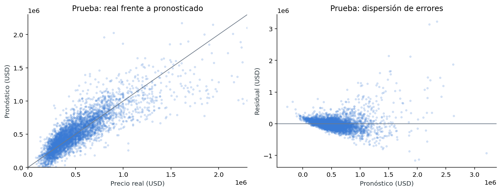
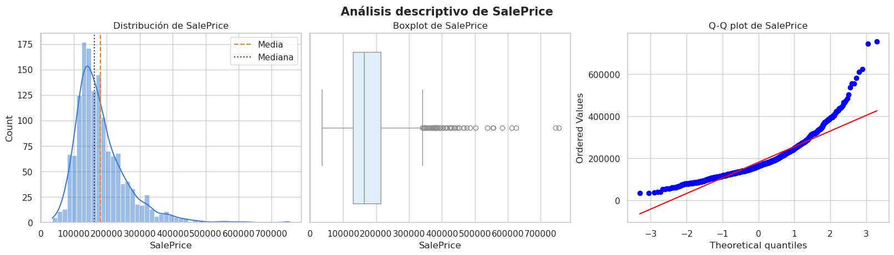
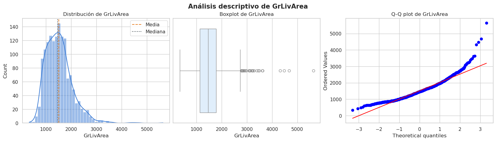

# Precios de vivienda · regresión y estadística

**Autor:** Javier Bueno Sánchez · EBAC, Profesión Científico de Datos

## Propósito

Estudiar atributos asociados al precio y evaluar modelos predictivos fuera de muestra.

## Técnicas

OLS, álgebra matricial, pruebas de hipótesis, VIF y diagnóstico de residuos.

## Archivos

- [Captura_Modulo51-1.png](Captura_Modulo51-1.png)
- [Captura_Modulo51-2.png](Captura_Modulo51-2.png)
- [Captura_Modulo51-3.png](Captura_Modulo51-3.png)
- [Modulo_51_Regresion_Matricial_Javier_Bueno.ipynb](Modulo_51_Regresion_Matricial_Javier_Bueno.ipynb)
- [Modulo_51_Regresion_Matricial_Javier_Bueno.pdf](Modulo_51_Regresion_Matricial_Javier_Bueno.pdf)
- [Modulo_52_Codigo.png](Modulo_52_Codigo.png)
- [Modulo_52_Pruebas_Hipotesis_JBS.ipynb](Modulo_52_Pruebas_Hipotesis_JBS.ipynb)
- [Modulo_52_Pruebas_Hipotesis_JBS.pdf](Modulo_52_Pruebas_Hipotesis_JBS.pdf)
- [Modulo_52_Resultados.png](Modulo_52_Resultados.png)
- [Practica_Estadistica_Avanzada_House_Pricing_Javier_Bueno.ipynb](Practica_Estadistica_Avanzada_House_Pricing_Javier_Bueno.ipynb)
- [Tarea M-33-CD Javier Bueno Sánchez..ipynb](Tarea%20M-33-CD%20Javier%20Bueno%20S%C3%A1nchez..ipynb)
- [Tarea M-33-CD Javier Bueno Sánchez..pdf](Tarea%20M-33-CD%20Javier%20Bueno%20S%C3%A1nchez..pdf)

## Datos y reproducción

Consulte [DATOS.md](DATOS.md). Abra Jupyter desde esta carpeta y ejecute las celdas en orden después de aportar los datos. El entorno sugerido está en [requirements.txt](../../requirements.txt); no se ha validado un entorno único para todas las actividades. Las salidas incluidas son históricas, no una ejecución nueva. Los archivos `.pbix` requieren Power BI Desktop y pueden necesitar restablecer las rutas de origen.

## Conclusiones documentadas en el trabajo

Los siguientes extractos proceden de los notebooks originales; no son resultados recalculados.

### Practica_Estadistica_Avanzada_House_Pricing_Javier_Bueno.ipynb

## 12. Conclusiones

1. `SalePrice`, `GrLivArea` y `2ndFlrSF` no siguen una distribución normal. Las pruebas analíticas y las visualizaciones coinciden; en `2ndFlrSF`, la gran cantidad de ceros responde a viviendas sin segundo piso.
2. Las variables más correlacionadas con precio son `OverallQual`, `GrLivArea`, `GarageCars`, `GarageArea`, `TotalBsmtSF` y `1stFlrSF`. Calidad, superficie y garaje concentran la mayor señal lineal.
3. El OLS inicial explica cerca de 81.3% de la variación en la muestra, pero combina variables no significativas y predictores que miden componentes similares de la propiedad.
4. La revisión conjunta de p-valores y VIF reduce el modelo de 36 a 19 variables, conserva prácticamente toda la capacidad explicativa y limita la multicolinealidad a niveles manejables.
5. En datos de prueba, el modelo final alcanza aproximadamente $R^2=0.827$ y RMSE de USD 36,459. Por tanto, ofrece una estimación razonablemente precisa para fines académicos y exploratorios, pero su error todavía es relevante para decisiones inmobiliarias individuales.
6. La siguiente mejora lógica sería incorporar variables categóricas —especialmente vecindario, calidad de cocina, tipo de vivienda y condición de venta— mediante codificación adecuada, estudiar una transformación logarítmica de `SalePrice`, tratar observaciones influyentes y comparar el desempeño mediante validación cruzada.

### Respuesta ejecutiva

El modelo es sólido como línea base: explica alrededor de ocho décimas partes de la variación del precio fuera de muestra. No obstante, no debe venderse como tasador definitivo. Los datos respaldan una buena capacidad de orientación, no precisión absoluta. La métrica resume el rendimiento; el análisis de residuos explica dónde y por qué puede fallar.

### Tarea M-33-CD Javier Bueno Sánchez..ipynb

**12. Conclusiones.**

1. `SalePrice`, `GrLivArea` y `2ndFlrSF` no siguen una distribución normal. Las pruebas analíticas y las visualizaciones coinciden; en `2ndFlrSF`, la gran cantidad de ceros responde a viviendas sin segundo piso.
2. Las variables más correlacionadas con precio son `OverallQual`, `GrLivArea`, `GarageCars`, `GarageArea`, `TotalBsmtSF` y `1stFlrSF`. Calidad, superficie y garaje concentran la mayor señal lineal.
3. El OLS inicial explica cerca de 81.3% de la variación en la muestra, pero combina variables no significativas y predictores que miden componentes similares de la propiedad.
4. La revisión conjunta de p-valores y VIF reduce el modelo de 36 a 19 variables, conserva prácticamente toda la capacidad explicativa y limita la multicolinealidad a niveles manejables.
5. En datos de prueba, el modelo final alcanza aproximadamente $R^2=0.827$ y RMSE de USD 36,459. Por tanto, ofrece una estimación razonablemente precisa para fines académicos y exploratorios, pero su error todavía es relevante para decisiones inmobiliarias individuales.
6. La siguiente mejora lógica sería incorporar variables categóricas —especialmente vecindario, calidad de cocina, tipo de vivienda y condición de venta— mediante codificación adecuada, estudiar una transformación logarítmica de `SalePrice`, tratar observaciones influyentes y comparar el desempeño mediante validación cruzada.

**Respuesta ejecutiva.**

El modelo es sólido como línea base: explica alrededor de ocho décimas partes de la variación del precio fuera de muestra. No obstante, no debe venderse como tasador definitivo. Los datos respaldan una buena capacidad de orientación, no precisión absoluta. La métrica resume el rendimiento; el análisis de residuos explica dónde y por qué puede fallar.
## Vista rápida

## Limitaciones

Trabajo formativo. Las asociaciones no establecen causalidad. El resultado depende de la fuente, la partición y los supuestos descritos en cada archivo. Revisar la disponibilidad y los derechos de los datos antes de publicarlos.
