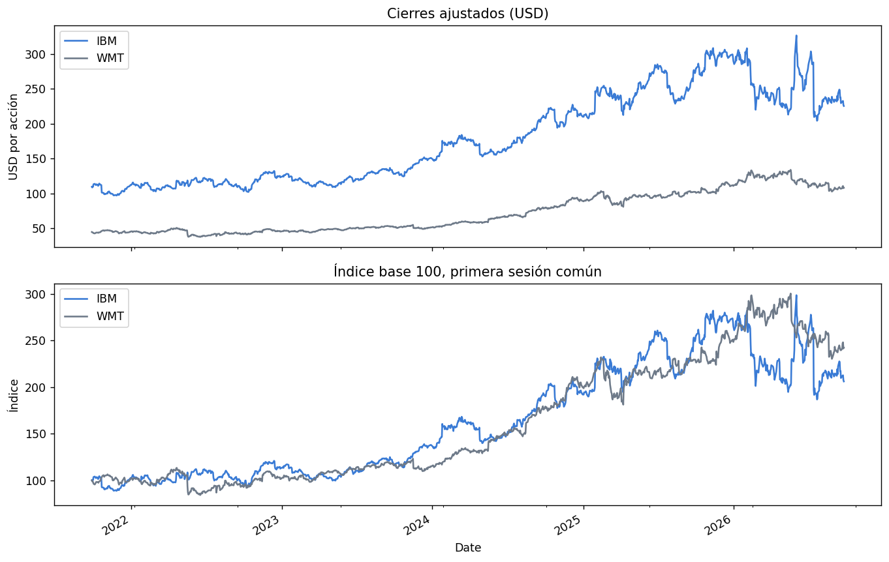
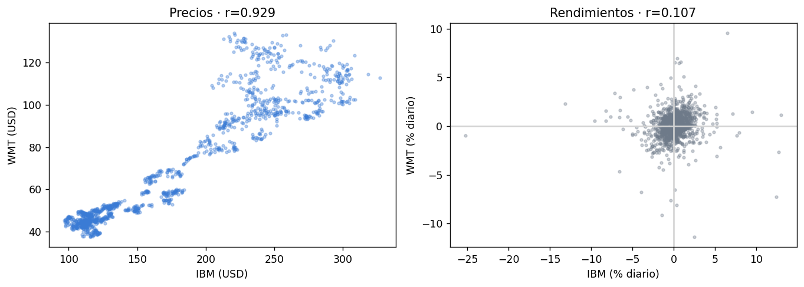
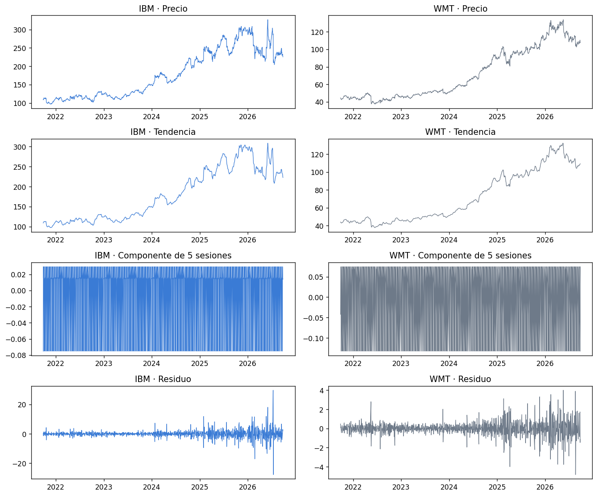

# IBM y Walmart · precios frente a rendimientos

**Autor:** Javier Bueno Sánchez · EBAC, Profesión Científico de Datos

## Propósito

Distinguir correlación de niveles y rendimientos y estudiar estacionariedad.

## Técnicas

Pearson, ADF, descomposición y pronóstico de referencia.

## Archivos

- [M54_Informe_IBM_Walmart_JBS.pdf](M54_Informe_IBM_Walmart_JBS.pdf)
- [M54_Series_Tiempo_IBM_Walmart_JBS.ipynb](M54_Series_Tiempo_IBM_Walmart_JBS.ipynb)
- [correlacion.png](correlacion.png)
- [correlogramas.png](correlogramas.png)
- [descomposicion.png](descomposicion.png)
- [pronostico.png](pronostico.png)

## Datos y reproducción

Consulte [DATOS.md](DATOS.md). Abra Jupyter desde esta carpeta y ejecute las celdas en orden después de aportar los datos. El entorno sugerido está en [requirements.txt](../../requirements.txt); no se ha validado un entorno único para todas las actividades. Las salidas incluidas son históricas, no una ejecución nueva. Los archivos `.pbix` requieren Power BI Desktop y pueden necesitar restablecer las rutas de origen.

## Conclusiones documentadas en el trabajo

Los siguientes extractos proceden de los notebooks originales; no son resultados recalculados.

### M54_Series_Tiempo_IBM_Walmart_JBS.ipynb

## Conclusiones y límites
- Los diagramas y Pearson permiten describir asociación histórica; la correlación en rendimientos responde mejor a la pregunta sobre movimientos diarios. Ninguna correlación establece causalidad.
- La descomposición con cinco sesiones es una ilustración descriptiva. La ACF de precios puede reflejar persistencia y tendencia, y no constituye por sí sola evidencia de estacionalidad o utilidad predictiva.
- ADF se interpreta por su hipótesis nula y su valor p, separadamente para precios y rendimientos.
- El pronóstico del siguiente día es un promedio calculado **antes** de conocer ese cierre. La comparación de prueba con la referencia de último cierre decide si el promedio móvil aporta valor. Incluso un MAPE bajo puede coexistir con errores de dirección o saltos de cotización: no es un modelo de inversión ni un intervalo de confianza.

**Fuente:** Yahoo Finance, API pública de gráficos diarios (`/v8/finance/chart/IBM` y `/WMT`), descargada para esta actividad. Los archivos CSV conservan la fotografía usada. Bibliotecas: pandas, statsmodels, matplotlib.
## Vista rápida

## Limitaciones

Trabajo formativo. Las asociaciones no establecen causalidad. El resultado depende de la fuente, la partición y los supuestos descritos en cada archivo. Revisar la disponibilidad y los derechos de los datos antes de publicarlos.
