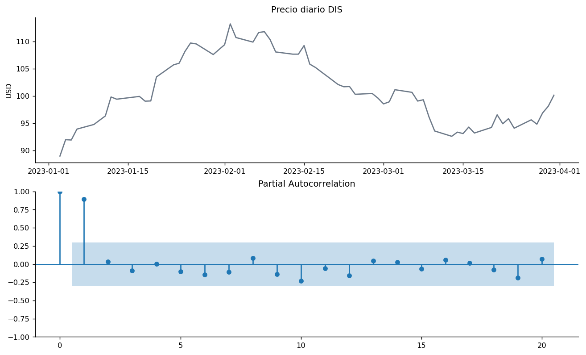
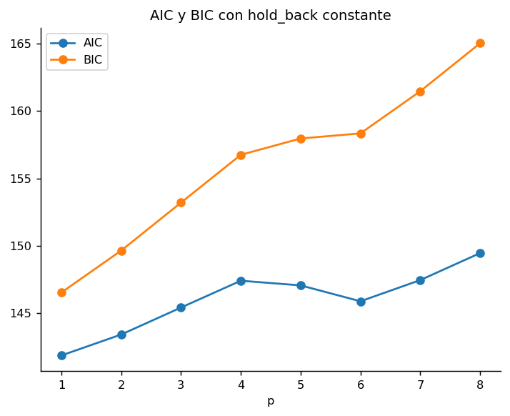
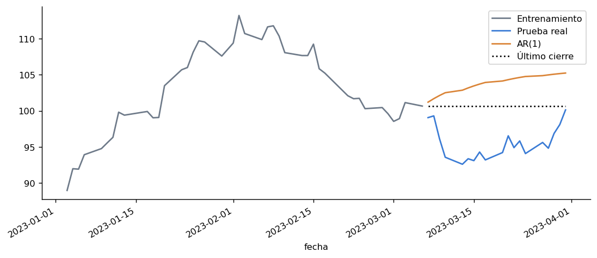

# Disney · modelos autorregresivos

**Autor:** Javier Bueno Sánchez · EBAC, Profesión Científico de Datos

## Propósito

Comparar órdenes AR y contrastar su capacidad predictiva con una referencia simple.

## Técnicas

AR(p), PACF, AIC, BIC y validación temporal.

## Archivos

- [01_serie_pacf.png](01_serie_pacf.png)
- [02_criterios.png](02_criterios.png)
- [03_validacion.png](03_validacion.png)
- [04_pronostico_abril.png](04_pronostico_abril.png)
- [05_codigo_y_validacion.png](05_codigo_y_validacion.png)
- [Modulo_55_DIS_ARp.ipynb](Modulo_55_DIS_ARp.ipynb)
- [Modulo_55_DIS_ARp.pdf](Modulo_55_DIS_ARp.pdf)

## Datos y reproducción

Consulte [DATOS.md](DATOS.md). Abra Jupyter desde esta carpeta y ejecute las celdas en orden después de aportar los datos. El entorno sugerido está en [requirements.txt](../../requirements.txt); no se ha validado un entorno único para todas las actividades. Las salidas incluidas son históricas, no una ejecución nueva. Los archivos `.pbix` requieren Power BI Desktop y pueden necesitar restablecer las rutas de origen.

## Conclusiones documentadas en el trabajo

Los siguientes extractos proceden de los notebooks originales; no son resultados recalculados.

### Modulo_55_DIS_ARp.ipynb

## Conclusión
La selección parsimoniosa requiere PACF, AIC y BIC, pero la aptitud para pronosticar se juzga en el tramo cronológico apartado y frente a un punto de referencia sencillo. El modelo AR(p) en niveles se interpreta con cautela cuando ADF no respalda estacionariedad. Se evita equiparar una métrica de ajuste o un intervalo nominal del modelo con certeza de precio futuro. Para mejorar el método se puede ampliar el historial, comparar ARIMA sobre diferencias y validar en múltiples ventanas móviles.
## Vista rápida

## Limitaciones

Trabajo formativo. Las asociaciones no establecen causalidad. El resultado depende de la fuente, la partición y los supuestos descritos en cada archivo. Revisar la disponibilidad y los derechos de los datos antes de publicarlos.
