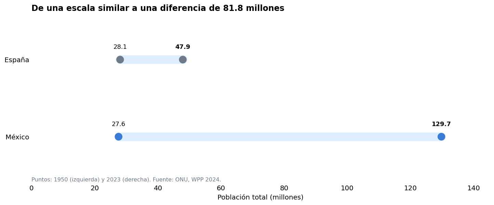
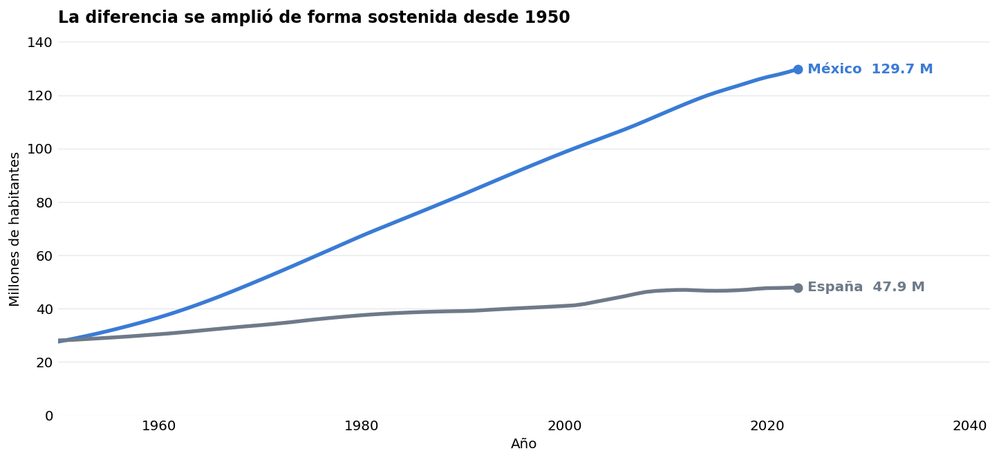
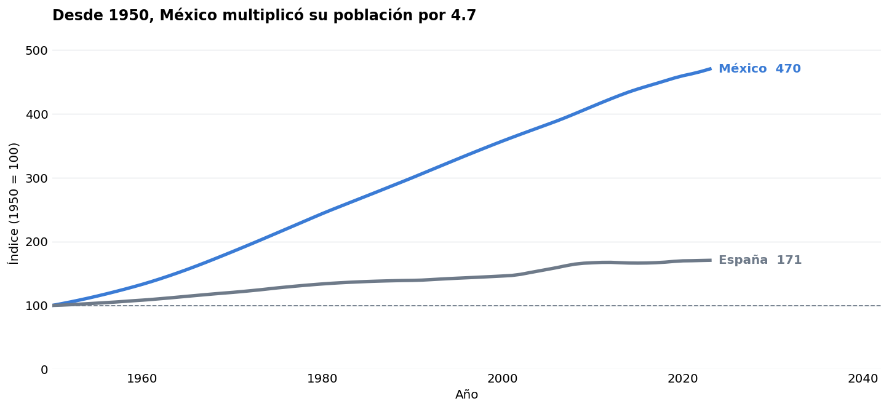

# México y España · storytelling demográfico

**Autor:** Javier Bueno Sánchez · EBAC, Profesión Científico de Datos

## Propósito

Comparar población absoluta y crecimiento relativo de 1950 a 2023.

## Técnicas

pandas, Matplotlib, índices base 100 y comunicación de resultados.

## Archivos

- [M57_Grafico_1.png](M57_Grafico_1.png)
- [M57_Grafico_2.png](M57_Grafico_2.png)
- [M57_Grafico_3.png](M57_Grafico_3.png)
- [M57_Storytelling_ONU_Evidencias.pdf](M57_Storytelling_ONU_Evidencias.pdf)
- [M57_Storytelling_ONU_Mexico_Espana.ipynb](M57_Storytelling_ONU_Mexico_Espana.ipynb)

## Datos y reproducción

Consulte [DATOS.md](DATOS.md). Abra Jupyter desde esta carpeta y ejecute las celdas en orden después de aportar los datos. El entorno sugerido está en [requirements.txt](../../requirements.txt); no se ha validado un entorno único para todas las actividades. Las salidas incluidas son históricas, no una ejecución nueva. Los archivos `.pbix` requieren Power BI Desktop y pueden necesitar restablecer las rutas de origen.

## Conclusiones documentadas en el trabajo

Los siguientes extractos proceden de los notebooks originales; no son resultados recalculados.

### M57_Storytelling_ONU_Mexico_Espana.ipynb

## Conclusión y límites
+1. **Demostrado por los datos:** México pasó de 27.6 a 129.7 millones (×4.70); España, de 28.1 a 47.9 millones (×1.71). En 2023 la distancia era de 81.8 millones.
+2. **Interpretación sustentada:** las dos series crecieron, pero México lo hizo mucho más en términos absolutos y relativos durante 1950–2023.
+3. **Por investigar:** cambios en fecundidad, mortalidad y migración pueden contribuir a explicar la divergencia; esta entrega no permite atribuir pesos causales.
+4. **Validación futura:** añadir esos indicadores de la ONU, armonizar sus periodos y comprobar si explican las etapas de mayor separación.
+
+### Decisiones visuales aplicadas
+
+| Principio | Decisión visible | Para qué sirve |
+|:--|:--|:--|
+| Gestalt: similitud | Azul constante para México; gris constante para España | Reconocer el país en las tres figuras |
+| Gestalt: continuidad | Líneas conectadas y eje temporal común | Seguir cada trayectoria sin reordenamientos |
+| Gestalt: proximidad | Valores y nombres junto a extremos de líneas y puntos | Asociar anotaciones con sus datos |
+| Prägnanz o buena forma | Dos series, títulos con mensajes y escalas sencillas | Identificar el patrón principal sin esfuerzo innecesario |
+| Tufte: claridad y economía gráfica | Sin 3D, sombras ni bordes superfluos; rejilla tenue | Priorizar los datos sobre adornos |
+| Holmes: recursos narrativos al servicio del dato | Títulos que anticipan el hallazgo y secuencia inicio → evolución → índice | Contar una historia legible sin ilustraciones que distorsionen magnitudes |
+
+**Precisión:** población al 1 de julio en miles en el CSV original; los gráficos expresan millones. La edición 2024 ofrece estimaciones históricas hasta 2023 y proyecciones desde 2024. Los valores son estimaciones demográficas, no recuentos censales anuales. No se extrapolan resultados fuera del periodo.
## Vista rápida

## Limitaciones

Trabajo formativo. Las asociaciones no establecen causalidad. El resultado depende de la fuente, la partición y los supuestos descritos en cada archivo. Revisar la disponibilidad y los derechos de los datos antes de publicarlos.
