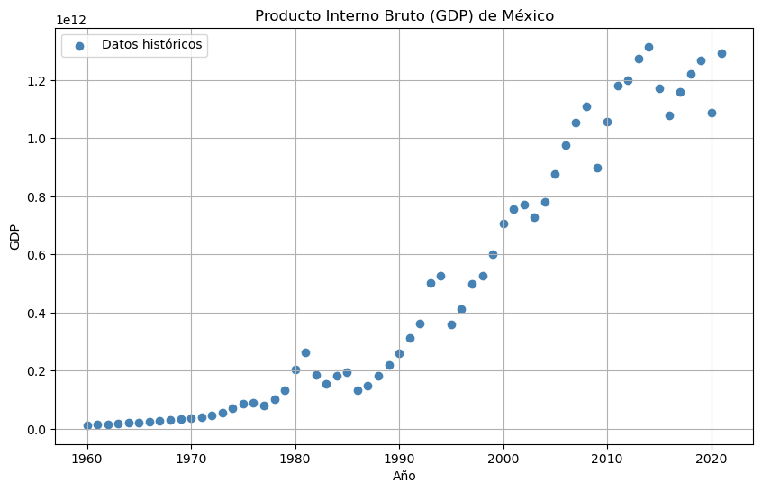
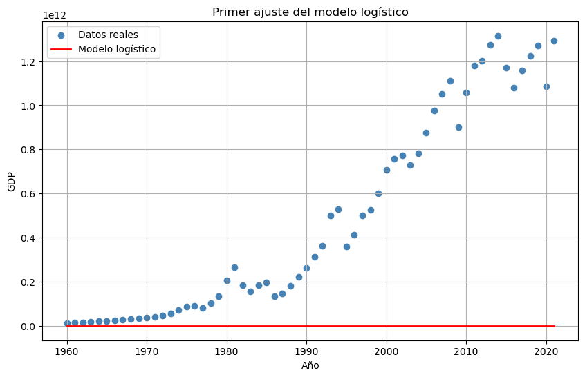
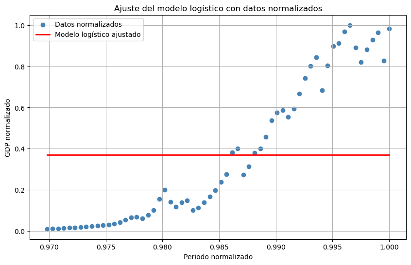

# PIB de México · regresión no lineal

**Autor:** Javier Bueno Sánchez · EBAC, Profesión Científico de Datos

## Propósito

Explorar un ajuste logístico del PIB y el efecto de normalizar las variables.

## Técnicas

SciPy, curve_fit, normalización y evaluación de ajuste.

## Archivos

- [Tarea M19-CD - Javier Bueno Sanchez.ipynb](Tarea%20M19-CD%20-%20Javier%20Bueno%20Sanchez.ipynb)
- [Tarea M19-CD Javier Bueno Sanchez.pdf](Tarea%20M19-CD%20Javier%20Bueno%20Sanchez.pdf)

## Datos y reproducción

Consulte [DATOS.md](DATOS.md). Abra Jupyter desde esta carpeta y ejecute las celdas en orden después de aportar los datos. El entorno sugerido está en [requirements.txt](../../requirements.txt); no se ha validado un entorno único para todas las actividades. Las salidas incluidas son históricas, no una ejecución nueva. Los archivos `.pbix` requieren Power BI Desktop y pueden necesitar restablecer las rutas de origen.

## Resultados y alcance

Las conclusiones y visualizaciones se encuentran en los informes y archivos del proyecto. No se transcriben métricas sin respaldo en un notebook de esta carpeta.

## Vista rápida

## Limitaciones

Trabajo formativo. Las asociaciones no establecen causalidad. El resultado depende de la fuente, la partición y los supuestos descritos en cada archivo. Revisar la disponibilidad y los derechos de los datos antes de publicarlos.
