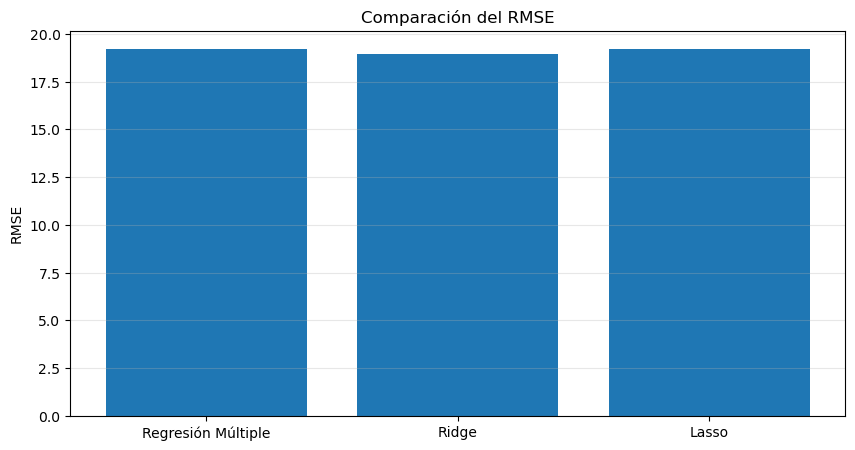

# Emisiones CO₂ · Ridge y Lasso

**Autor:** Javier Bueno Sánchez · EBAC, Profesión Científico de Datos

## Propósito

Comparar regresión lineal y regularización para estimar emisiones.

## Técnicas

Escalado, regresión lineal, Ridge, Lasso y validación cruzada.

## Archivos

- [Tarea M20-CD Javier Bueno Sanchez-1.pdf](Tarea%20M20-CD%20Javier%20Bueno%20Sanchez-1.pdf)
- [Tarea M20-CD Javier Bueno Sanchez.ipynb](Tarea%20M20-CD%20Javier%20Bueno%20Sanchez.ipynb)
- [Tarea M20-CD Javier Bueno Sanchez.pdf](Tarea%20M20-CD%20Javier%20Bueno%20Sanchez.pdf)

## Datos y reproducción

Consulte [DATOS.md](DATOS.md). Abra Jupyter desde esta carpeta y ejecute las celdas en orden después de aportar los datos. El entorno sugerido está en [requirements.txt](../../requirements.txt); no se ha validado un entorno único para todas las actividades. Las salidas incluidas son históricas, no una ejecución nueva. Los archivos `.pbix` requieren Power BI Desktop y pueden necesitar restablecer las rutas de origen.

## Conclusiones documentadas en el trabajo

Los siguientes extractos proceden de los notebooks originales; no son resultados recalculados.

### Tarea M20-CD Javier Bueno Sanchez.ipynb

###  Conclusión final.

Se desarrollaron tres modelos de regresión para pronosticar las emisiones de CO₂: una regresión múltiple, una regresión Ridge y una regresión Lasso.

Los resultados muestran que los tres modelos presentan un buen desempeño, con valores de R² cercanos al 90 %, lo que indica una alta capacidad para explicar la variabilidad de la variable objetivo.

El modelo Ridge obtuvo el mejor desempeño general al alcanzar el mayor coeficiente de determinación (R² = 0.9032) y los menores valores de MSE (358.68) y RMSE (18.94). Esto indica que fue el modelo con mayor capacidad predictiva y mejor generalización para este conjunto de datos.

La regresión múltiple presentó el menor MAE; sin embargo, la diferencia con Ridge y Lasso fue muy pequeña y no compensó el mejor desempeño global de Ridge en las demás métricas.

El modelo Lasso mostró un desempeño similar al de la regresión múltiple y eliminó automáticamente la variable MODELYEAR al asignarle un coeficiente igual a cero. Esto demuestra su capacidad para realizar selección automática de variables y generar modelos más simples e interpretables.

En conclusión, el modelo Ridge fue el más adecuado para esta base de datos, ya que proporcionó el mejor equilibrio entre precisión, estabilidad y capacidad de generalización.
## Vista rápida

## Limitaciones

Trabajo formativo. Las asociaciones no establecen causalidad. El resultado depende de la fuente, la partición y los supuestos descritos en cada archivo. Revisar la disponibilidad y los derechos de los datos antes de publicarlos.
