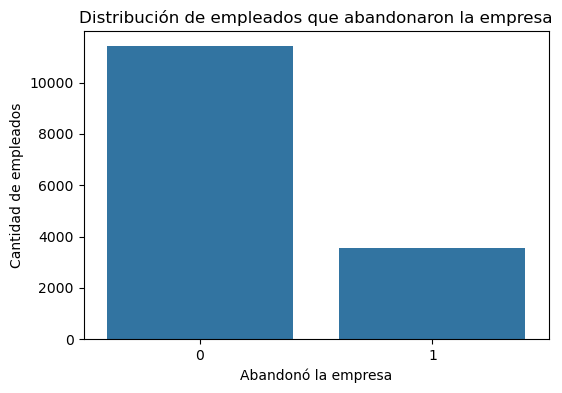
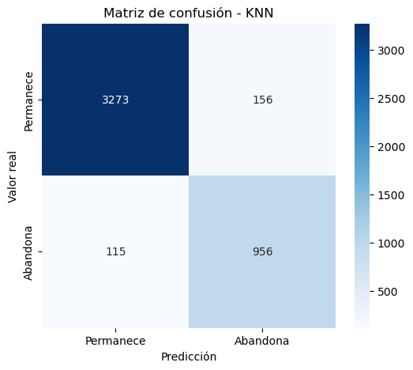
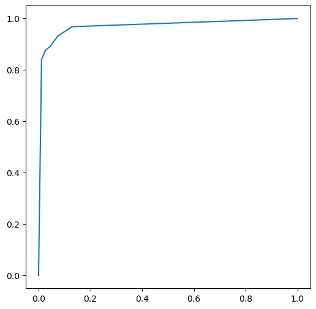

# Permanencia laboral · KNN y SVM

**Autor:** Javier Bueno Sánchez · EBAC, Profesión Científico de Datos

## Propósito

Explorar clasificación de permanencia laboral a partir de datos de recursos humanos.

## Técnicas

KNN, SVM, escalado y evaluación de clasificación.

## Archivos

- [Tarea M21-CD Javier Bueno Sanchez.ipynb](Tarea%20M21-CD%20Javier%20Bueno%20Sanchez.ipynb)
- [Tarea M21-CD Javier Bueno Sanchez.pdf](Tarea%20M21-CD%20Javier%20Bueno%20Sanchez.pdf)
- [Tarea M22-CD - Javier Bueno Sanchez..ipynb](Tarea%20M22-CD%20-%20Javier%20Bueno%20Sanchez..ipynb)
- [Tarea M22-CD - Javier Bueno Sanchez..pdf](Tarea%20M22-CD%20-%20Javier%20Bueno%20Sanchez..pdf)

## Datos y reproducción

Consulte [DATOS.md](DATOS.md). Abra Jupyter desde esta carpeta y ejecute las celdas en orden después de aportar los datos. El entorno sugerido está en [requirements.txt](../../requirements.txt); no se ha validado un entorno único para todas las actividades. Las salidas incluidas son históricas, no una ejecución nueva. Los archivos `.pbix` requieren Power BI Desktop y pueden necesitar restablecer las rutas de origen.

## Conclusiones documentadas en el trabajo

Los siguientes extractos proceden de los notebooks originales; no son resultados recalculados.

### Tarea M21-CD Javier Bueno Sanchez.ipynb

# Conclusiones finales.

### Tarea M22-CD - Javier Bueno Sanchez..ipynb

## Conclusión final

El análisis demuestra que la elección del kernel influye directamente en la capacidad predictiva del modelo. Aunque todos los modelos utilizan Máquinas de Soporte Vectorial, cada kernel construye fronteras de decisión diferentes. En este caso, el kernel RBF fue el que mejor logró representar el comportamiento de los datos, permitiendo identificar con mayor precisión a los empleados con riesgo de abandonar la empresa. Esto demuestra la importancia de comparar distintos modelos antes de implementar una solución basada en Machine Learning.
## Vista rápida

## Limitaciones

Trabajo formativo. Las asociaciones no establecen causalidad. El resultado depende de la fuente, la partición y los supuestos descritos en cada archivo. Revisar la disponibilidad y los derechos de los datos antes de publicarlos.
