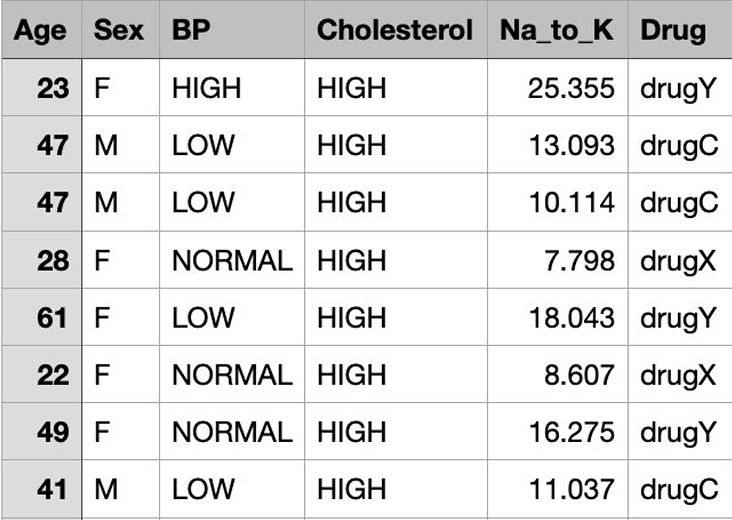
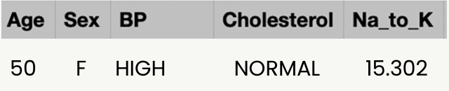
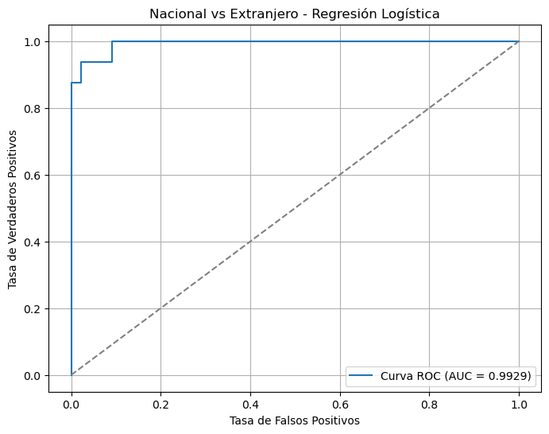

# Clasificación · árboles y ensambles

**Autor:** Javier Bueno Sánchez · EBAC, Profesión Científico de Datos

## Propósito

Comparar árboles de decisión y ensambles sobre ejercicios académicos de clasificación.

## Técnicas

Árboles, Random Forest, AdaBoost, Gradient Boosting y ROC.

## Archivos

- [Source.gv](Source.gv)
- [Tarea M23-CD Javier Bueno Sanchez.ipynb](Tarea%20M23-CD%20Javier%20Bueno%20Sanchez.ipynb)
- [Tarea M23-CD Javier Bueno Sanchez.pdf](Tarea%20M23-CD%20Javier%20Bueno%20Sanchez.pdf)
- [Tarea M24-CD Javier Bueno Sanchez.ipynb](Tarea%20M24-CD%20Javier%20Bueno%20Sanchez.ipynb)
- [Tarea M24-CD Javier Bueno Sanchez.pdf](Tarea%20M24-CD%20Javier%20Bueno%20Sanchez.pdf)
- [Tarea M25-CD Javier Bueno Sanchez.ipynb](Tarea%20M25-CD%20Javier%20Bueno%20Sanchez.ipynb)
- [arbol_decision_gini.png](arbol_decision_gini.png)

## Datos y reproducción

Consulte [DATOS.md](DATOS.md). Abra Jupyter desde esta carpeta y ejecute las celdas en orden después de aportar los datos. El entorno sugerido está en [requirements.txt](../../requirements.txt); no se ha validado un entorno único para todas las actividades. Las salidas incluidas son históricas, no una ejecución nueva. Los archivos `.pbix` requieren Power BI Desktop y pueden necesitar restablecer las rutas de origen.

## Conclusiones documentadas en el trabajo

Los siguientes extractos proceden de los notebooks originales; no son resultados recalculados.

### Tarea M23-CD Javier Bueno Sanchez.ipynb

11. Conclusiones.

- Se implementó correctamente un modelo de Árbol de Decisión utilizando Scikit-learn para clasificar el medicamento recomendado a partir de las características clínicas de los pacientes.
Los criterios de división Gini y Entropía obtuvieron el mismo desempeño sobre el conjunto de prueba, alcanzando una exactitud del 98.33%, lo que indica que ambos son igualmente adecuados para este conjunto de datos.

- La visualización del árbol permitió interpretar las reglas de decisión utilizadas por el modelo, facilitando comprender cómo cada variable influye en la clasificación.

- Finalmente, el modelo fue utilizado para predecir el medicamento recomendado para un nuevo paciente, obteniendo como resultado drugY, demostrando la capacidad del algoritmo para apoyar procesos de clasificación supervisada.

### Tarea M24-CD Javier Bueno Sanchez.ipynb

10. Conclusiones.

- Se implementó correctamente un modelo de Árbol de Decisión y los métodos de ensambles RandomForestClassifier, AdaBoostClassifier, GradientBoostingClassifier utilizando Scikit-learn para clasificar el medicamento recomendado a partir de las características clínicas de los pacientes.
Los métodos de ensambles RandomForestClassifier obtuvo el mismo desempeño que el Árbol de Decisión con una exactitud del 98.33%, mientras que AdaBoostClassifier y GradientBoostingClassifier obtuvieron el mismo desempeños menores sobre el conjunto de prueba, alcanzando una exactitud del 83.33% y 96.67% respectivamente, lo que indica que Árbol de Decisión y RandomForestClassifier presentaron un rendimiento equivalente en este conjunto de datos.

### Tarea M25-CD Javier Bueno Sanchez.ipynb

11. Conclusiones.
## Vista rápida

## Limitaciones

Trabajo formativo. Las asociaciones no establecen causalidad. El resultado depende de la fuente, la partición y los supuestos descritos en cada archivo. Revisar la disponibilidad y los derechos de los datos antes de publicarlos.
