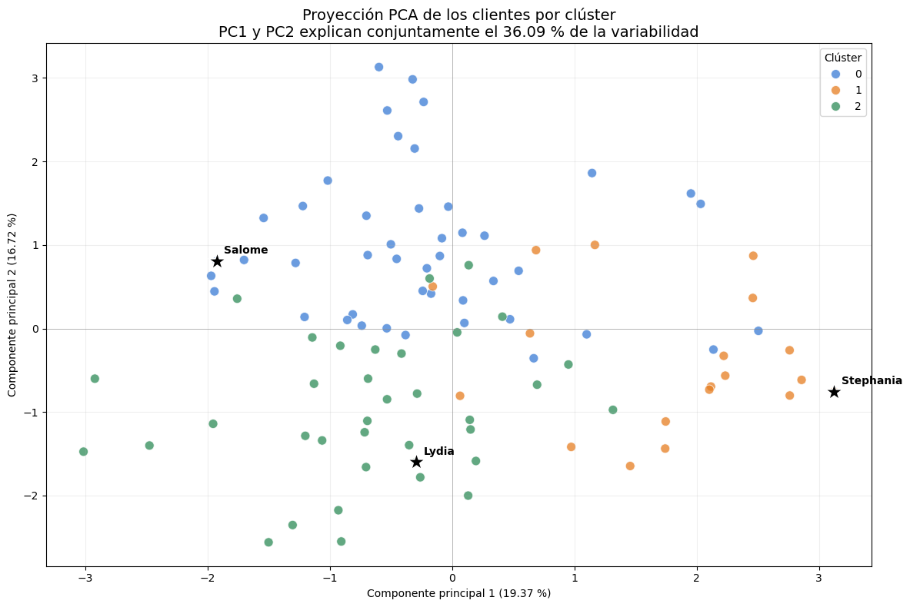

# Amazon · clustering jerárquico

**Autor:** Javier Bueno Sánchez · EBAC, Profesión Científico de Datos

## Propósito

Agrupar perfiles de evaluación y explorar recomendaciones por similitud.

## Técnicas

Ward, dendrogramas, distancias y PCA.

## Archivos

- [Dendrograma Amazon.pdf](Dendrograma%20Amazon.pdf)
- [Tarea M 26-CD Javier Bueno Sanchez.ipynb](Tarea%20M%2026-CD%20Javier%20Bueno%20Sanchez.ipynb)
- [Tarea M26-CD Javier Bueno Sanchez.pdf](Tarea%20M26-CD%20Javier%20Bueno%20Sanchez.pdf)
- [dendrograma_amazon.png](dendrograma_amazon.png)

## Datos y reproducción

Consulte [DATOS.md](DATOS.md). Abra Jupyter desde esta carpeta y ejecute las celdas en orden después de aportar los datos. El entorno sugerido está en [requirements.txt](../../requirements.txt); no se ha validado un entorno único para todas las actividades. Las salidas incluidas son históricas, no una ejecución nueva. Los archivos `.pbix` requieren Power BI Desktop y pueden necesitar restablecer las rutas de origen.

## Conclusiones documentadas en el trabajo

Los siguientes extractos proceden de los notebooks originales; no son resultados recalculados.

### Tarea M 26-CD Javier Bueno Sanchez.ipynb

<b>Conclusión análisis:<b/>

La proyección PCA muestra ciertas tendencias en la distribución de los tres clústeres. El clúster 0 se concentra principalmente en la región superior y central; el clúster 1, hacia valores positivos de PC1; y el clúster 2, en la región inferior e izquierda. No obstante, se observa una superposición considerable, especialmente alrededor del centro de la gráfica.

Esta mezcla visual es coherente con los bajos coeficientes de silueta obtenidos anteriormente y respalda la conclusión de que los grupos representan perfiles aproximados, no segmentos claramente separados.

Salome se ubica en una zona predominantemente asociada al clúster 0, aunque próxima a observaciones de otro grupo. Stephania presenta la posición más periférica y se localiza en la región ocupada principalmente por el clúster 1. Lydia aparece dentro de la zona inferior correspondiente mayoritariamente al clúster 2.

Debido a que PC1 y PC2 explican conjuntamente solo el 36.09 % de la variabilidad, esta representación conserva poco más de un tercio de la información original. Por ello, PCA aporta una lectura visual de las tendencias y la superposición entre los grupos, pero no permite validar por sí solo la calidad del clustering ni sustituye las distancias calculadas con las nueve variables estandarizadas.

<b>Conclusión sobre PCA:</b> 

La proyección PCA es coherente con la débil separación señalada por la silueta, pero no modifica las recomendaciones ni demuestra similitud entre productos.
## Vista rápida

## Limitaciones

Trabajo formativo. Las asociaciones no establecen causalidad. El resultado depende de la fuente, la partición y los supuestos descritos en cada archivo. Revisar la disponibilidad y los derechos de los datos antes de publicarlos.
