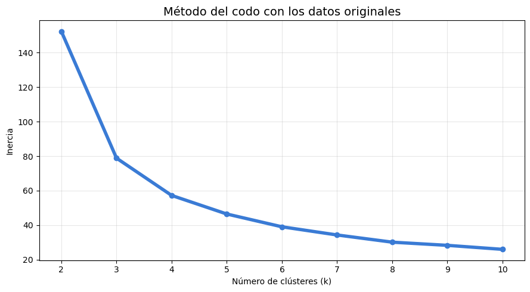
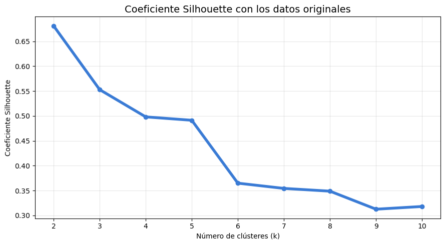
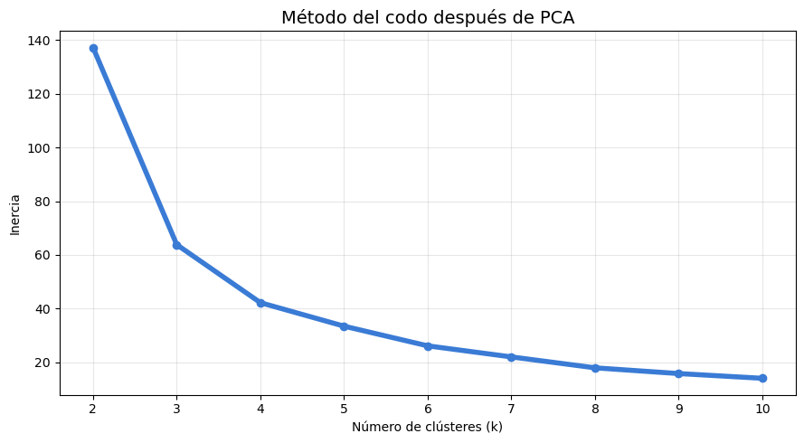

# Iris · K-Means y PCA

**Autor:** Javier Bueno Sánchez · EBAC, Profesión Científico de Datos

## Propósito

Comparar agrupamiento y reducción de dimensionalidad sobre Iris.

## Técnicas

K-Means, codo, silueta y PCA.

## Archivos

- [Tarea M-27 CD Javier Bueno Sanchez.ipynb](Tarea%20M-27%20CD%20Javier%20Bueno%20Sanchez.ipynb)
- [Tarea M-27 CD Javier Bueno Sanchez.pdf](Tarea%20M-27%20CD%20Javier%20Bueno%20Sanchez.pdf)
- [Tarea M28-CD Javier Bueno Sanchez.ipynb](Tarea%20M28-CD%20Javier%20Bueno%20Sanchez.ipynb)

## Datos y reproducción

Consulte [DATOS.md](DATOS.md). Abra Jupyter desde esta carpeta y ejecute las celdas en orden después de aportar los datos. El entorno sugerido está en [requirements.txt](../../requirements.txt); no se ha validado un entorno único para todas las actividades. Las salidas incluidas son históricas, no una ejecución nueva. Los archivos `.pbix` requieren Power BI Desktop y pueden necesitar restablecer las rutas de origen.

## Conclusiones documentadas en el trabajo

Los siguientes extractos proceden de los notebooks originales; no son resultados recalculados.

### Tarea M-27 CD Javier Bueno Sanchez.ipynb

<b>14. Conclusiones.</b>

El análisis con K-Means mostró que los datos contienen una estructura de agrupamiento consistente. El método del codo señaló tres clústeres, mientras que el indicador Silhouette favoreció dos grupos por presentar mayor cohesión y separación. Esta diferencia se explica porque Setosa forma un grupo claramente separado, mientras Versicolor y Virginica tienen características parcialmente solapadas.

Después de aplicar PCA, los dos componentes explican el 97.77 % de la varianza. Los resultados de agrupamiento no fueron exactamente iguales, pero sí prácticamente equivalentes: solo una observación cambió de grupo y el índice de Rand ajustado alcanzó 0.9803.

La principal ventaja práctica de PCA fue reducir el conjunto de cuatro variables a dos dimensiones, facilitando la visualización directa de los clústeres y simplificando el análisis con una pérdida de información de apenas 2.23 %. Además, el coeficiente Silhouette aumentó tanto para k=2, de 0.6810 a 0.7057, como para k=3, de 0.5528 a 0.5977, lo que indica una separación ligeramente más clara en el espacio reducido.

Sin embargo, PCA también reduce la interpretación directa de las variables, porque los componentes representan combinaciones de las medidas originales. Por tanto, su ventaja principal en este ejercicio es la simplificación y visualización del problema, mientras que las variables originales siguen siendo más útiles para describir las características concretas de cada grupo.

### Tarea M28-CD Javier Bueno Sanchez.ipynb

El análisis de componentes principales permitió reducir las cuatro variables numéricas de la base Iris a dos componentes, conservando el **95.81% de la varianza total**. PC1 explica el **72.96%** y PC2 el **22.85%**, por lo que la representación bidimensional conserva prácticamente toda la estructura relevante de los datos.

PC1 está relacionado principalmente con el tamaño de los pétalos. Esta dimensión separa claramente a Setosa, caracterizada por pétalos pequeños, y sitúa a Virginica en el extremo opuesto por sus pétalos largos y anchos. Versicolor mantiene una posición intermedia, aunque presenta cierto solapamiento con Virginica.

PC2 está determinado principalmente por la anchura del sépalo. Este componente aporta una diferenciación vertical entre observaciones, pero su capacidad para separar especies es menor que la de PC1.

La comparación de los mapas demuestra que ambos cumplen funciones complementarias:

- El mapa de observaciones permite identificar agrupamientos, separaciones y solapamientos entre las especies.
- El mapa de factores explica qué variables originan esas posiciones.
- La revisión de los índices 22, 118, 60 y 15 confirma que la interpretación visual coincide con las mediciones originales.

En conclusión, el PCA ofrece una representación eficiente y comprensible de la base Iris. La separación entre especies depende principalmente de las dimensiones del pétalo, mientras que la anchura del sépalo explica buena parte de la variación secundaria. Sin embargo, el solapamiento observado entre Versicolor y Virginica indica que el PCA facilita la exploración y visualización de la estructura de los datos, pero no garantiza por sí solo una clasificación perfecta.
## Vista rápida

## Limitaciones

Trabajo formativo. Las asociaciones no establecen causalidad. El resultado depende de la fuente, la partición y los supuestos descritos en cada archivo. Revisar la disponibilidad y los derechos de los datos antes de publicarlos.
